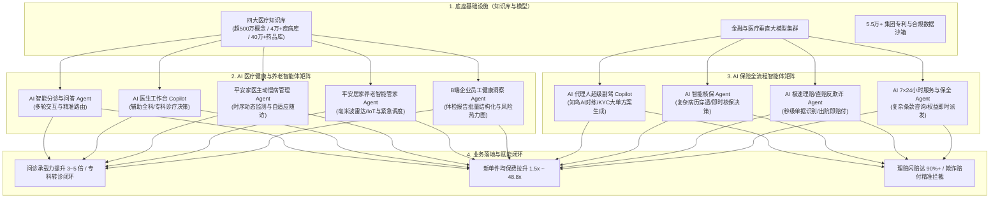
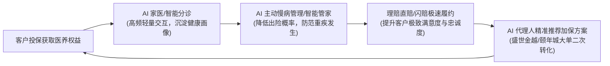

# 平安集团 AI 健康与保险智能体应用场景及落地业务分析

> 本文档基于本仓库内的 [[06.平安健康用户场景与产品价值分析]]、[[10.平安代理人渠道与健康管理协同机制]]、[[09.平安高端医养套餐与现场升单机制]] 以及专利库 [[9.外部对接/2.专利及算法/平安健康与平安好医生健康管理专利布局及研发专利路线调研]]，结合平安最新财报、技术白皮书及行业公开信息，系统梳理平安集团在 **AI 健康医疗**、**精准养老** 与 **保险主业** 中的核心 AI 智能体（AI Agents）架构、业务应用场景、落地成效及对富德的实施借鉴。

---

# 一、 平安 AI 落地架构与技术底座

平安集团在 AI 领域的落地并非单纯开发几个对话问答工具，而是构建了**“底层医疗/金融知识库 + 垂直领域大模型 + 专职 Agent 编排调度 + 终端业务飞轮”**的完整体系。

---

# 二、 AI 在【健康医疗与养老领域】的五大核心智能体场景

在医疗与养老端，平安以**平安健康（平安好医生）**与**平安医保科技**为阵地，通过 AI 智能体深度嵌入严肃医疗场景，实现了自有 3000+ 名医生团队与万名医养服务经理的高效人机协同。

---

### 1. AI 智能分诊与问答智能体（AI Triage Agent）
*   **入口场景**：平安健康 App、平安金管家健康专区、微信小程序。
*   **核心功能**：
    *   **语义理解与主诉解析**：处理用户口语化、碎片化的症状描述；
    *   **多轮追问与信息补全（对应专利 `CN112035636B`）**：若患者主诉信息不足，Agent 依据知识图谱决策树主动生成 2~3 个结构化问题（如询问持续时长、伴随症状、是否有既往病史等）；
    *   **精准路由**：将患者秒级导流至 38,000+ 细分专科或对应的全科医生，分诊准确率超 99%。

---

### 2. AI 医生工作台与辅助决策 Copilot（AI Doctor Copilot）
*   **入口场景**：自有 3000+ 名全职医生日常在线接诊系统、互联网医院医生端。
*   **核心功能**：
    *   **病历秒级自动生成（对应专利 `CN112036154B`）**：实时监听医患在线沟通内容，自动过滤寒暄与重复分句，秒级生成标准的 SOAP 格式电子病历草稿，医生仅需一键确认；
    *   **临床决策支持（CDSS）**：根据病历与主诉，实时推荐疑似疾病、鉴别诊断要点及检查检验建议；
    *   **合理用药审查**：在开具处方时，智能体自动校验配伍禁忌、超剂量、过敏史及重复用药，实现处方合规拦截率 100%；
    *   **业务成效**：使单名医生的日常在线服务承载能力提升 3~5 倍，问诊质量与合规率保持在 99.9% 以上。

---

### 3. 平安家医“主动慢病管理智能体”（Proactive Chronic Care Agent）
*   **入口场景**：“平安臻享RUN”会员专属慢病服务、家医签约高血压/糖尿病管理。
*   **核心功能**：
    *   **动态健康画像生成（对应专利 `CN112185561B`）**：接入智能血压计、血糖仪等 IoT 监测数据，结合 OCR 体检报告（专利 `CN115762698B`），构建多维时序健康档案；
    *   **自适应随访策略编排（对应专利 `CN113643813B`）**：根据指标波动情况动态调整随访频率，自动推送饮食营养方案、运动处方及用药打卡提醒；
    *   **异常指标熔断机制**：一旦发现生理指标持续超标或出现危急值，Agent 自动触发红色预警并即时转接真人家医电话介入。

---

### 4. 居家养老“7×24小时智能管家智能体”（Home Care Smart Agent）
*   **入口场景**：平安“居家养老”品牌、适老化家庭改造客户家庭终端。
*   **核心功能**：
    *   **多模态无感安全监测**：连接毫米波防跌倒雷达、智能睡眠带、燃气烟雾报警器、智能水表等；
    *   **行为异常识别**：通过空间雷达反射波束算法，在不使用摄像头侵犯隐私的前提下，高灵敏度识别长者是否在洗手间/卧室发生跌倒或起夜滞留超时；
    *   **秒级三级联动调度**：识别跌倒后，3 秒内触发智能音箱呼叫长者 $\to$ 电话通知家属 $\to$ 调度本地护联体/120 急救上门履约。

---

### 5. B 端企业员工健康管理与洞察 Agent（Corporate Health Agent）
*   **入口场景**：平安健康 B 端企业员工健康福利（“安有职”计划）。
*   **核心功能（对应专利 `CN112037915A`）**：
    *   批量自动解析上万名企业员工体检报告，自动脱敏并聚类生成企业整体“健康风险大盘与疾病热力图”；
    *   为企业 HR 智能制定定制化健康干预方案（如针对伏案人员的颈椎病/脂肪肝改善营养），并向员工端精准推送个性化复查提醒。

---

# 三、 AI 在【保险业务全流程】的四大核心智能体场景

在保险核心价值链中，平安通过 AI 智能体全面重构了传统保险作业模式：

| 保险价值链 | 核心 AI 智能体 | 核心能力与技术特点 | 业务落地成效 |
| :--- | :--- | :--- | :--- |
| **展业销售** | **AI 代理人超级副驾 (Agent Copilot / 平安知鸟)** | • **千人千面 AI 陪练**：模拟刁钻客户对练展业话术 • **大单方案生成**：结合客户资产与家庭生命周期，自动生成“保险+居家养老/颐年城”个性化配置方案与促单对比表 | • 代理人培训上线周期缩短 40% • 助力件均保费拉升 **1.5~48.8倍** |
| **核保承保** | **AI 智能核保 Agent (AI Underwriting)** | • 多模态解析复杂门诊病历、体检指标与既往出险记录 • 构建带病体（结节、三高等）恶性转化预测模型，自动完成差异化加费/除外承保计算 | • 寿险/重疾险自动化核保率超 **90%** • 核保结论由数天缩短至秒级 |
| **理赔履约** | **AI 极速理赔/直赔 Agent (AI Claims Agent)** | • 医疗票据、发票、病历多模态 OCR 识别与防伪校验 • 规则引擎+图计算自动匹配保单条款与医保目录，智能拦截反欺诈 | • “闪赔”平均用时 **< 3分钟** • 医疗险“直赔”实现出院免垫资免申请 |
| **客户运营** | **7×24小时全能坐席 Agent (AI Servicing Agent)** | • 自然语言处理复杂条款咨询、保单贷款、犹豫期挽留、保全变更 • 养老社区探店预约、家医权益一键激活与派发 | • 智能客服一次性解决率超 **95%** • 替代海量传统人工坐席话务 |

---

# 四、 平安 AI 智能体赋能的商业闭环与飞轮效应

平安的 AI 智能体并非单纯的成本中心或技术实验，而是已经深度融入了集团的**“保险 + 医养”商业飞轮**中：

### 1. 降低赔付成本（控费减损）
通过主动慢病管理 Agent 与健康干预，帮助慢性病与亚健康客户控制指标，延缓并发症发生，直接降低了健康险与医疗险的实际赔付率。

### 2. 提升客户续保率与加保率
财报数据显示，享有并使用平安医养生态权益的客户，其 13 个月继续率和客均保单合同数明显高于普通客户，且加保率提升了近 6 个百分点。

### 3. 极速履约拉升品牌美誉度
通过 AI 闪赔（3分钟赔付）与合作医院出院直赔（系统自动抵扣），彻底颠覆了传统保险“理赔难、手续繁、垫资久”的行业痛点。

---

# 五、 平安核心专利与算法链路拆解（避坑指南）

平安在医疗健康 AI 领域布局了数千件专利，同业在自研或采购相关系统时，应重点规避以下几条高度密集的专利权利要求链路：

1.  **问诊系统问答管理（专利 `CN112035636B`）**：
    *   *特征*：获取问诊文本 $\to$ 神经网络判断信息是否齐全 $\to$ 知识图谱生成多轮补充问题 $\to$ 补齐数据生成诊断。
    *   *规避建议*：改用“静态表单引导 + 医生人工一键追问模板”，避免采用完全自动化的图谱多轮闭环自生成机制。
2.  **对话自动写入电子病历（专利 `CN112036154B`）**：
    *   *特征*：获取对话分句 $\to$ 划分病历类别 $\to$ 语义相似度去重 $\to$ 填入对应病历栏目。
    *   *规避建议*：将对话记录仅作为“待确认文本线索”展示在侧边栏，由医生手动勾选或点击填入，不进行全自动后台病历静默组装。
3.  **基于人工智能的慢病随访监管（专利 `CN113643813B`）**：
    *   *特征*：周期采集数据 $\to$ 病理知识图谱提取特征 $\to$ XGBoost 风险打分 $\to$ 生成用户画像 $\to$ 匹配并执行目标随访策略。
    *   *规避建议*：将随访规则与风险模型解耦，由临床专家制定固定规则矩阵，避免使用“机器学习风险分 $\to$ 策略标签相似度匹配”的端到端自动化编排链路。

---

# 六、 对富德等险企在 AI 智能体布局上的启示

结合 [[20.富德复制平安模式的资质与组织阻力]]，富德生命人寿与联好健康无需盲目投入数十亿自研底层通用大模型，而应聚焦于**“成熟底座 + 场景卡位 + 垂类智能体单点突破”**：

1.  **优先落地“AI 代理人超级副驾（Agent Copilot）”**：
    *   将富德现有的“鑫禧年年”、“美好生活”等主力年金和健康险条款向量化，打造嵌入个险/银保渠道展业端的小程序智能体，辅助代理人现场进行产品答疑、客户画像分析与分档权益推荐。
2.  **打造轻量化“AI 预防保健助手”**：
    *   在富德健康端聚焦于**“体检报告 OCR 结构化解析”**与**“AI 运动打卡/饮食提醒”**，以极低的边际成本为保单客户提供日常高频连接。
3.  **建设“AI 辅助核保与快赔规则引擎”**：
    *   引入成熟的医疗 OCR 与核保规则模型，先在标准体和轻症医疗险上跑通秒级自动核保与快赔，逐步沉淀自有的精算与风控数据资产。
