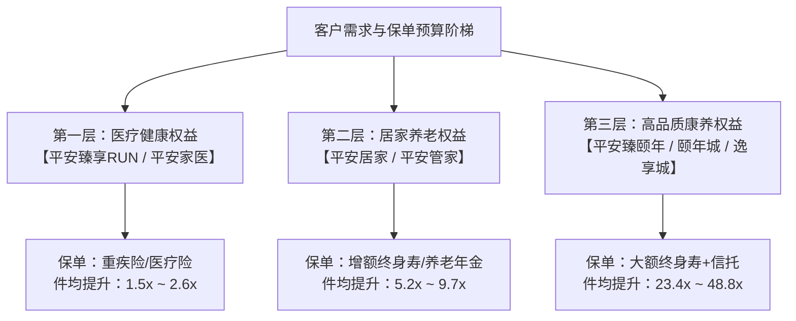
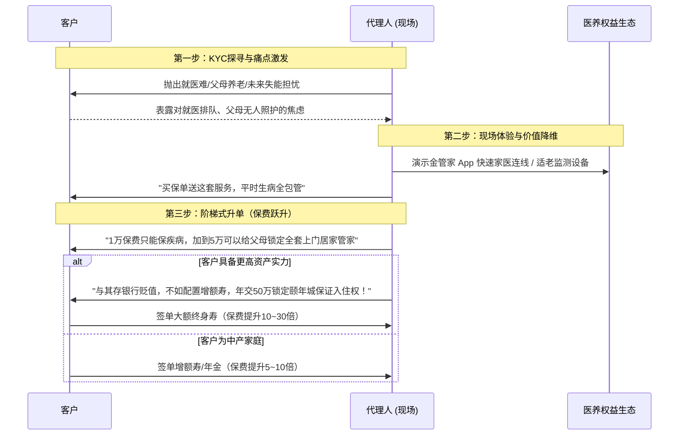

# 平安高端医养套餐定义、底层保单配置与现场升单机制拆解

结合对文档 [[10.平安代理人渠道与健康管理协同机制]] 以及平安最新公开财报、产品配置矩阵和代理人一线销售实务的深度调研，为您对平安的**高端套餐定义、保单配置拆解、现场升单路径以及件均保费拉升 1.5～23.4 倍（2026年最新中报已达 2.6～48.8 倍）的底层机制**进行全景透视与深度拆解。

---

# 一、 平安医养套餐体系的分层定义（“货”的标准化包装）

平安之所以能让几十万没有医学背景的代理人卖出高端大单，核心在于将复杂的医疗、照护、养老资源高度**“标准化权益包化”**，划分出三个界限分明、层层递进的套餐体系：

### 1. 第一层：医疗健康套餐（平安臻享RUN / 平安家医）
*   **目标客群**：大众中产、年轻家庭、基础保障客群。
*   **版本分级**：
    *   **乐享RUN**：基础家庭医生、日常健康咨询、小病诊疗建议、慢病预防、大病专案管理。
    *   **尊享RUN**：在乐享基础上增加**音视频快速极速问诊、运动达标三重奖、检查报告深度解读**。
    *   **尊享RUN Plus（或臻悦版）**：健康服务中的“品质版”，配备专属全科医生、挂号就医绿通、住院协调、全程就医陪诊、术后上门护理等 12~18 项权益。
*   **服务本质**：以**“到线（线上问诊）+ 关键节点到院（绿通/陪诊）”**为主的轻资产医疗健康服务。

### 2. 第二层：居家养老套餐（平安居家 / 平安管家）
*   **目标客群**：中产家庭、为父母养老买单的中年骨干、自身准备退休养老客群。
*   **服务定位**：满足“9073”格局中 90%“不离家、不离亲”的居家养老需求。
*   **核心内容（“1个管家 + 7好王牌服务体系”）**：
    *   **三位一体管家**：智能管家（音箱/雷达等全天候监测报警）+ 生活管家（文娱、适老改造、日常协助）+ 医生管家（慢病随访、专属家医）。
    *   **实体到家服务**：提供适老化居家改造方案、专业护士/护理员上门照护（护联体）、远程防跌倒雷达报警、慢病专项干预方案。
*   **服务本质**：以**“智能硬件 + 本地化护士/养老服务商上门履约”**为主的线上线下结合服务。

### 3. 第三层：高品质康养套餐（平安臻颐年）
*   **目标客群**：高净值（HNW）及超高净值（UHNW）家庭、企业主、家族财富传承客群。
*   **服务定位**：核心城市核心地段（城芯）顶级机构 CCRC 养老社区与家族私享医疗。
*   **版本分级**：
    *   **逸享会员（逸享城）**：新一线或核心二线城市（如佛山、武汉、苏州等）高品质养老社区入住权益。
    *   **臻享会员（颐年城）**：一线城市核心黄金地段（如上海静安8号、深圳福田、北京等）顶级康养社区入住权益，细分为 **V1、V2、V3 级**。
*   **核心权益**：
    *   **保证入住权 / 优先入住权**（免排队、终身锁定床位）；
    *   **亲属共享权**（本人及配偶、双方父母均可享有保证或优先入住资格）；
    *   **私董保健医 / 名医二诊**（全国顶尖三甲名医面对面、海外就医转诊协助）；
    *   **资产与品质双锁定**（保单现金流支付未来月费，实现资产隔离与医养闭环）。
*   **服务本质**：以**“核心城市核心地段重资产实体社区 + 顶级医疗团队”**为底座的顶层奢华权益。

---

# 二、 底层保单配置与缴费方案详细拆解

平安的医养权益**不对外单独收费**，而是作为特定保单的**准入门槛与附加对价**。以下是三层套餐挂钩的主流保单配置模型：

| 套餐层级 | 挂钩主力保单险种 | 典型缴费配置方案 | 累计总保费门槛 | 对应件均倍数逻辑 |
| :--- | :--- | :--- | :--- | :--- |
| **基础医疗健康** (臻享RUN/家医) | **重疾险/医疗险** • 御享福 / 盛世福 / 平安六福 • 平安 e 生保百万医疗 | • 年交：6,000 ~ 15,000 元 • 缴费期：20年 / 30年交 | **累计 10万 ~ 30万** (按单笔首期保费约1万元计算) | **基准 ~ 1.5倍** (解决日常看病找医生，保障型客户的标配) |
| **中端居家养老** (平安居家管家) | **增额终身寿 / 养老年金** • 盛世金越系列 • 御享财富 / 御享金瑞 | • 年交：5万 ~ 10万元 • 缴费期：3年 / 5年 / 10年交 | **累计 30万 ~ 100万+** (首期件均约5万~10万元) | **5.2倍 ~ 9.7倍** (从纯保障跃升为现金流储蓄与居家照护) |
| **顶端高品质康养** (平安臻颐年) | **大额增额寿 / 终身寿 / 信托** • 盛世金越至尊版 • 传世赢家 + 保险金信托 | • **逸享城**：年交 58.8万×10年 • **颐年城V1**：年交 188.8万×10年 • **颐年城V2/V3**：年交 328万/438万×10年 | • **逸享城：588万 起** • **颐年城：1888万 / 3288万 / 4388万** | **23.4倍 ~ 48.8倍** (家族资产配置、财富传承与稀缺养老床位锁定) |

---

# 三、 现场如何让不同客户升单？（升单全流程与促单实操拆解）

在销售现场，平安代理人绝不会把健康管理当成“附赠小礼品”，而是将其作为**“探寻需求痛点 $\to$ 提升保单预算 $\to$ 促成阶梯升单”的战略杠杆**。

### 1. 现场客户分层识别（KYC）与痛点匹配

代理人通过现场简单 3 个问题快速给客户归类：
*   **A 类（工薪/大众白领）**：预算 5,000~15,000 元，核心痛点是“生病没钱治、医院排不上队”。
    *   **促单锚点**：重疾保障 + 尊享 RUN（解决全家小病问诊与大病就医绿通）。
*   **B 类（中产/富裕中坚）**：预算 3万~10万元，核心痛点是“父母在外地无人照料、自己未来失能失智怎么办、财富如何稳健增值”。
    *   **促单锚点**：增额终身寿 + 平安居家养老管家（解决适老改造、护士上门、防跌倒监控与养老现金流）。
*   **C 类（高净值/企业主）**：预算 50万~数百万以上，核心痛点是“资产安全隔离、财富代际传承、晚年有尊严的高端城芯医养”。
    *   **促单锚点**：大额终身寿/信托 + 臻颐年保证入住权（解决高端圈层、顶级医疗、免排队入住与家族财富传承）。

---

### 2. 现场促单与升单的四大核心话术与心理杠杆

#### 杠杆 ①：心理账户重塑——把“消费支出”转变为“资产储蓄与资格赠送”
*   **困境**：让客户买 1 万元的消费型重疾险，客户觉得是“花钱消费”，极其敏感。
*   **现场升单话术**：
    > “王总，花 1 万块买纯消费保险，钱花了就没了。但如果您每年把原本要理财的 10 万元放到平安‘盛世金越’里，这笔钱不仅本金安全、终身复利增值、随时可以保单贷款周转，**更关键的是，您直接免费拿到了平安价值百万的‘居家养老管家’资格**，父母生病有专属护士上门，家里还免费装防跌倒智能雷达。钱还是您的资产，服务相当于白送！”
*   **效果**：客户从抗拒 1 万元消费，变成了愿意投入 10 万元做资产配置（**件均保费直接拉高 10 倍**）。

#### 杠杆 ②：稀缺性与确定性锚定——抢占“不可替代的医疗养老稀缺配额”
*   **困境**：高净值客户不缺普通理财产品，对年化 2%~3% 的增额寿险兴趣不大。
*   **现场升单话术**：
    > “李董，您现在不缺钱，但未来 10 年您最缺的是什么？是一线城市核心地段顶级的医疗和养老床位！上海静安区、深圳福田区的核心康养社区总共就几百套房间，外面排队有钱都进不去。
    > 平安‘臻颐年’规定，**只有累计保费达到 1888 万的客户，才享有‘终身保证入住权’，而且可以写上您父母和岳父母的名字**。买国债买基金买不来床位保证，但这份大单把您全家三代的顶奢养老资格彻底锁死了。”
*   **效果**：将金融产品的竞争降维为“稀缺生存与医疗特权争夺”，推动高净值客户签下数百上千万保单（**件均保费拉高 23.4～48.8 倍**）。

#### 杠杆 ③：现场实物与交互体验（沉浸式成交）
平安代理人在现场并不是空口讲条款，而是依靠丰富的体验工具：
*   **App 现场真机连线**：现场打开“平安金管家”，一键呼叫 7×24 小时家庭医生，现场解答客户或其家人的体检报告、小毛病，让客户**当场感受 60 秒接通公立全科医生的震撼**。
*   **适老智能设备实物展示**：携带毫米波防跌倒雷达、智能跌倒报警手表到客户家中或展业点现场演示：“只要老人在洗手间滑倒，雷达不需摄像头就能自动识别，管家 3 秒钟内就会给您打电话报警并派护士上门”。
*   **VR/实景探店体验营销**：邀请中高端客户前往“颐年城”体验厅、居家养老客户体验中心进行沉浸式茶歇与沙龙，在实体环境中完成大单促成。

#### 杠杆 ④：大单拆期交——降低“千万门槛”的现场支付抗拒
*   **现场促单技巧**：
    > “1888 万听起来很多，但并不是要您今天一次性拿出 1888 万。我们配置 10 年期交的增额寿险，每年只需交 188.8 万，您企业的日常利润分红直接覆盖。交满 10 年后，账户里的现金价值已经增值超过了 2000 万，您不仅拥有了巨额现金流，而且保证入住权终身有效！”

---

# 四、 总结与核心结论

1.  **“1.5～23.4 倍（乃至 48.8 倍）”的统计学真相**：
    *   并不是同一张重疾险因为加了健康管理从 1 万涨价到了 23 万（监管严格禁止超 10%/2% 的搭售加价）；
    *   而是通过**“医疗健康（基础） $\to$ 居家养老（中端） $\to$ 机构康养（顶端）”**这套权益阶梯，**把客户从“买小单保障的普通客户”筛选、转化并升单为“买大额年金/终身寿/信托的财富与养老客户”**。

2.  **对同业（如富德生命人寿及联好健康）的借鉴路径**：
    *   **不要让代理人去卖健康管理**：代理人卖的是保单，健康管理必须包装成简单明确的“分档权益对照表”；
    *   **打造中间档的“居家养老/健康管家”金钩子**：大众客户用线上家医（1.5倍），中产客户用居家养老管家/适老改造/护士上门（5~10倍），这是最具性价比、转化量最大的区间；
    *   **盘活存量重资产（如富德河源巴伐利亚庄园）**：利用现成的 840 套云健康公寓、温泉疗养和基因早筛包装为“高端度假旅居权益”，无需盲目斥资几十亿新建 CCRC，就能为代理人提供冲击大单的现场实物营销抓手。
