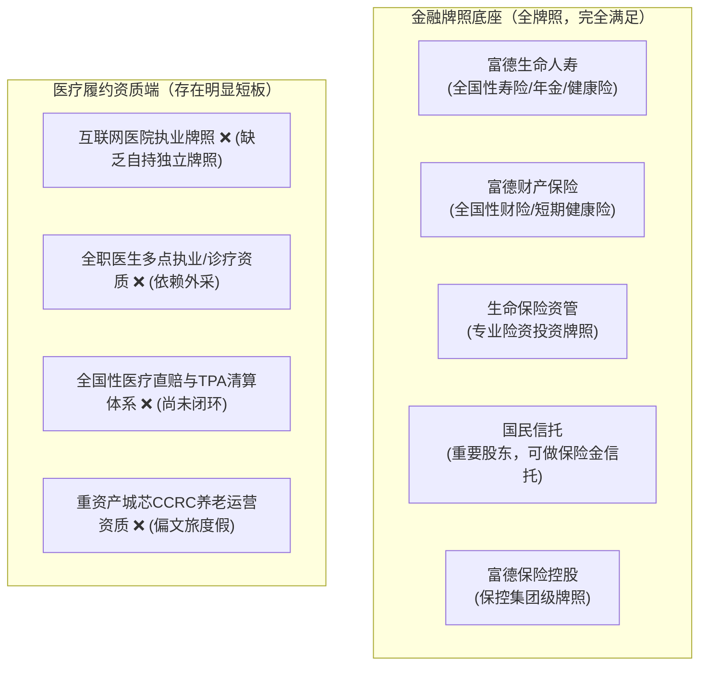
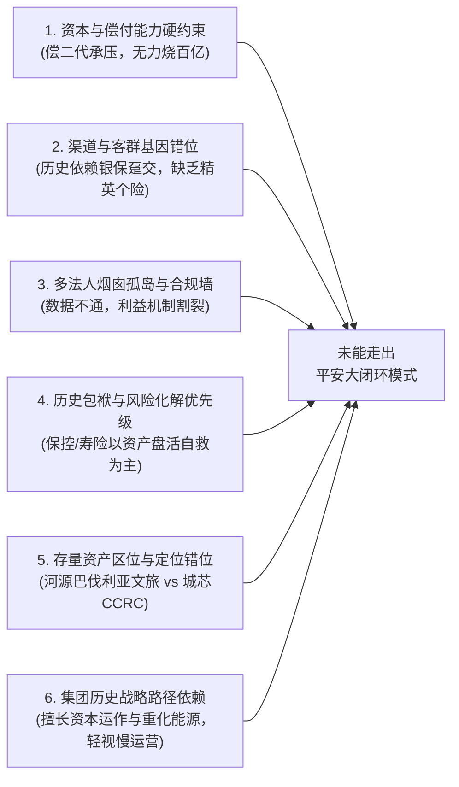

# 富德保险牌照资质审查与复制平安模式的阻力深度拆解

结合对文档 [[10.平安代理人渠道与健康管理协同机制]]、[[17.富德与平安高净值客户及履约能力对比]] 以及富德集团金融牌照、历史沿革与偿付能力监管背景的深度调研，对富德在“保险 + 健康 / 养老”生态打法上的**牌照资质评估**、**为何坐拥庞大集团资源却没有走通平安模式**，以及**深层阻力拆解**，为您进行深度透视与客观剖析。

---

# 一、 资质与牌照审查：富德的牌照到底够不够？缺什么？

结论先行：**在“金融与保险主业”层面，富德的牌照不仅完全足够，甚至是国内极少数具备金控级配置的集团；但在“医疗健康与严肃医养履约”的牌照资质端，存在明显的结构性短缺。**

### 1. 金融与保险主业牌照：资质完全具备
*   **富德生命人寿（全国寿险牌照）**：经营范围依法包含人寿保险、年金保险、健康保险、意外伤害保险。平安卖增额终身寿（盛世金越）、大额年金（御享财富）以及重疾险（平安福）所依据的正是寿险牌照，富德生命人寿在法律和产品审批上**完全具备设计同类型高价值大单的全部资质**，无需额外申请独立的“养老险公司”或“健康险公司”牌照。
*   **富德财产保险（全国财险牌照）**：可经营短期意健险、企业团险、责任险等。
*   **生命资产管理 & 国民信托**：拥有全套资金运作和信托牌照，完全具备开展“千万级大额保单 + 保险金信托 + 养老现金流隔离”顶层玩法的法定义务资质。

### 2. 医疗健康与养老履约端：核心资质缺失
要支撑平安那套“现场 60 秒连线、全国名医二诊、床位锁定”的履约，光有保险牌照不够，还需要底层医疗资质：
*   **缺乏自持的全国互联网医院执业牌照**：平安拥有平安好医生（自持互联网医院、具备在线处方、诊疗、审方资质）；富德联好健康目前主要是科技/健康管理服务主体，缺乏自持的严肃医疗执业资质，无法像平安那样合规开展具有处方权和医疗责任的闭环诊疗。
*   **缺乏自有全职全科/专科医生队伍资质**：平安自建了近 3000 人的自有全职医疗团队和万名服务经理；富德目前依赖“三师共管（全科+专科+健管师）”的轻量化整合，大部分专科医生与公立医院资源依赖第三方合作采购，履约控制力受制于人。

---

# 二、 集团内懂战略的人不少，为什么没有复制平安打法？（阻力深度拆解）

富德作为千亿级体量的保险金融集团，战略研究和高管层自然深知“保险+医养”的大势。之所以多年来未能走出平安这套闭环，并非“看不懂”，而是被**资本实力、监管约束、渠道基因、内部治理、历史资产包袱和战略认知**等 6 大深层阻力锁死。

---

## 阻力 1：资本金与偿付能力的刚性硬约束（致命伤）

*   **平安模式的本质是“极度消耗资本”的重投入体系**：
    *   平安健康（平安好医生）自成立起**累计烧钱超过 100 亿元**才换来全套自建医疗网络；
    *   平安臻颐年（颐年城）在一线城市黄金地段拿地建 CCRC，动辄沉淀几十亿甚至上百亿长周期险资，且对保险公司的**核心偿付能力充足率**有极高要求（监管规定开展养老社区业务的险企净资产不得低于 50 亿元，且偿付能力需长期达标）。
*   **富德的现实困境**：
    *   根据公开信息，富德生命人寿在 2021 年末综合偿付能力充足率约为 103%、核心偿付能力充足率仅 87%（逼近监管红线警戒线），随后多年处于偿付能力信息暂缓披露状态；
    *   在自身资本金极为紧张、面临“偿二代二期”资本穿透监管和防范利差损的高压下，**集团根本没有多余的百亿级流动资本去给健康科技烧钱，更无法大规模砸钱在北上广深自建重资产养老社区**。

---

## 阻力 2：销售渠道与客群结构的“基因错位”

*   **平安的底盘是“几十万精英代理人 + 平安银行高净值私行客群”**：
    *   平安能够现场把保单拉高 1.5～23.4 倍，前提是其代理人经过严格的 MVP/QVP 顾问式销售培训，且平安银行私行源源不断导流千万级高净值客户，客户买得起增额寿和信托。
*   **富德的底盘是“历史银保渠道 + 三四线下沉客群”**：
    *   富德生命人寿历史上快速崛起，依靠的是**银保渠道大规模销售理财型、趸交型、中短存续期产品（如高现价万能险等）**；
    *   **银保网点的柜员和一般中介只看产品“预期收益率和返点”**，根本不会花 2 个小时去给客户讲解“慢病管理、家庭医生或适老化改造”；
    *   富德的个险代理人队伍规模与精英化程度与平安、友邦存在代际差距，缺乏能够向高净值客户兜售“几百万至上千万大单”的综合财务规划师队伍。

---

## 阻力 3：集团内部“多法人烟囱式壁垒”与数据合规防火墙

内部协同难以打通是制约转型的关键组织阻力：
*   **跨主体利益考核不一致**：富德生命人寿、富德产险、富德数智、富德联好健康各自为独立法人。寿险关心的是保费规模和新业务价值，健康/科技板块关心的是系统建设和用户活跃度。健康板块如果要求寿险按单补贴服务费，寿险会视其为“纯成本侵蚀利润”；健康板块如果免费提供服务，自身又无法形成商业化盈利。
*   **数据孤岛与合规红线**：根据《个人信息保护法》及金监总局规定，金融机构与健康管理平台之间存在极其严格的数据防火墙。从内部材料《关于开展"健康管理服务对保险经营指标影响"关联验证的授权申请》可见，**仅仅为了做一次脱敏的聚合层级数据对比（验证健康服务是否能提升续保率），都需要层层上报集团特批**。这种严密的跨主体数据壁垒，导致前后端无法形成类似平安的“客户画像-智能核保-自动派发权益”数字飞轮。

---

## 阻力 4：战略重心差异：长期处于“化险自救与存量整改”阶段

*   **平安的发展阶段**：公司治理结构成熟、资本雄厚，战略重心早已进入“保险+综合金融+医疗养老”生态扩张的收获期。
*   **富德的发展阶段**：过去数年里，富德生命人寿经历了实际控制人变动、高管频繁更迭、资产端（如部分地产与非标投资）受困以及监管合规整顿的严峻考验。集团和险企管理层的核心精力长期被**“流动性管理、化险防风险、资产处置盘活专班、应对合规罚单”**占据。在“防御生存与合规自保”的周期内，管理层很难有战略定力和财务宽裕度去推动耗时数年的大生态工程。

---

## 阻力 5：历史存量重资产的“区位与功能错位”

富德并非没有投过重资产，但选型与平安迥异：
*   **富德的重资产**：早年出资打造的**广东河源巴伐利亚庄园（生命如意家园，840 套公寓）**，属于**“异地文旅度假 + 温泉疗养”模式**。它远离北上广深一线核心医疗资源，适宜低龄老人短期旅居，但无法提供高龄失能老人所需的“常住持续照护（CCRC）”与三甲重症绿通。
*   **平安的重资产**：直接布局在北上广深核心区（城芯模式），紧邻华东医院、中山医院等顶尖三甲，精准击中超高净值人群“离医疗近、离子女近、离熟悉圈子近”的刚需。
*   **结果**：富德的历史重资产资金已被沉淀在文旅基地中，难以在全国复制，无法为全国代理人提供高频、刚需的现场促单抓手。

---

## 阻力 6：企业基因的路径依赖（“资本与能源运作” vs “精细化医养运营”）

*   富德集团的深层商业基因在于**“大资本运作、股权投资举牌、能源化工（如富德能源、近期设立的210亿新能源投资）”**。这类业务属于资本密集型，注重资源、牌照和资本规模，习惯于“大进大出、快速起量”；
*   而医疗健康与养老服务属于**“极度精细化、极度依赖微观运营、长周期、微利”**的重服务业务。用搞能源、化工和资本运作的思维去管医疗和养老，极易产生“投入产出比不划算、见效太慢、管理成本极重”的战略不适感，导致健康板块在集团内部容易被边缘化为“技术辅助部门”或“外包装饰”。

---

# 三、 破局路径：富德不应该盲目“抄平安”，而应“扬长避短”

既然富德不具备平安的百亿级烧钱资本和全国城芯 CCRC 实力，盲目照搬平安的重资产模式只会加剧财务负担。更务实、更可行的突围策略应当是：

| 维度 | 平安模式（不可盲目照搬） | 富德现实突围策略（轻资产、盘活存量） |
| :--- | :--- | :--- |
| **基础医疗（1.5x）** | 自建平安好医生、自聘3000名全职医生 | **联合采购 + 自研轻量 AI 助手**：与镁信、圆心或头部 TPA 合作医疗绿通，自研 AI 健康助手赋能金管家。 |
| **中端居家（5~10x）** | 自建全国服务网络与全套硬件 | **聚焦“富德管家 + 居家适老”**：以轻资产居家养老为核心抓手，将“护士上门、适老改造、慢病随访”打包进年金/增额寿产品（如鑫禧年年）。 |
| **顶端机构（20x+）** | 耗资数百亿全国自建颐年城 CCRC | **盘活存量 + 借船出海**： 1. **盘活河源巴伐利亚庄园**：包装为“高端温泉度假 / 华大基因早筛健康假期”，作为中高端保单实物体验抓手； 2. **外部合作准入**：与泰康之家、大家保险等成熟 CCRC 运营商签订床位商业合作协议，免除自建包袱。 |
